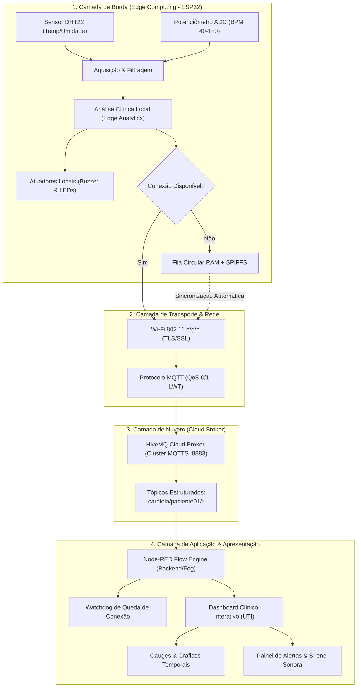

# ARQUITETURA DO SISTEMA CARDIOIA
## A Nova Era da Cardiologia Inteligente com IoT, Edge e Cloud Computing

---

## 1. Visão Geral da Arquitetura em Camadas

O **CardioIA** foi concebido sob o paradigma de arquitetura hierárquica para sistemas ciberfísicos e dispositivos médicos de missão crítica (*Medical IoT* - IoMT). O sistema divide suas responsabilidades em quatro camadas interligadas:

---

## 2. Detalhamento das Camadas Técnicas

### 2.1 Camada 1: Borda Inteligente (Edge Computing)
- **Dispositivo Central:** Microcontrolador ESP32 dual-core Xtensa LX6 @ 240MHz.
- **Aquisição de Sinais:**
  - **Frequência Cardíaca (BPM):** Simulação via potenciômetro conectado ao pino **GPIO 34 (ADC1_CH6)**. A escolha do canal **ADC1** é mandatória no ESP32, visto que os canais ADC2 tornam-se inoperantes quando o rádio Wi-Fi está em transmissão.
  - **Condicionamento de Sinal na Borda:** Implementação de algoritmo de média móvel com janela deslizante de 5 amostras ($N=5$), atenuando oscilações de ruído elétrico e flutuações bruscas do potenciômetro antes da conversão para a escala de 40 a 180 BPM.
  - **Temperatura e Umidade:** Sensor digital DHT22 conectado ao **GPIO 15**, operando via protocolo proprietário de fio único (*Single-Wire*), com tempo de resposta calibrado a cada 3 segundos.
- **Processamento e Decisão Local:**
  - Avaliação algorítmica das variáveis vitais em tempo de execução ($\Delta t < 10\text{ ms}$).
  - Disparo prioritário de atuadores físicos de emergência (LED Vermelho no GPIO 4 e Buzzer Piezo no GPIO 5) sem depender de resposta ou autorização da nuvem.
  - LED Verde indicador de normalidade (Heartbeat) no GPIO 2.

### 2.2 Camada 2: Resiliência Offline e Sincronização
- **Fila Circular em Memória RAM (FIFO):**
  - Armazena até 60 amostras completas (`OfflineTelemetryRecord`), permitindo reter até 3 minutos de histórico ininterrupto de monitoramento sem conexão Wi-Fi.
  - Alocação de memória estática pré-reservada em tempo de compilação, eliminando fragmentação de *heap* (*Heap Fragmentation*) e risco de *Out Of Memory* (OOM).
  - Política de transbordo: quando a capacidade máxima é atingida, o registro mais antigo é substituído pelo mais recente, garantindo a retenção dos dados hemodinâmicos mais críticos do paciente.
- **Persistência em SPIFFS (*SPI Flash File System*):**
  - O código implementa o espelhamento persistente dos dados na partição de memória Flash SPIFFS (`/cardioia_offline.dat`). Em caso de reinicialização ou queda de energia do vestível em campo, as leituras são restauradas no *boot*.
- **Mecanismo de Despejo e Sincronização com Confirmação (Zero Data Loss):**
  - O registro pendente é lido via `peek()`.
  - É publicado via MQTT com a flag `"is_synced_data": true` e seu respectivo timestamp original de medição.
  - O descarte do buffer local ocorre **exclusivamente após** a recepção do ACK de envio bem-sucedido (`confirmTransmission()`).

### 2.3 Camada 3: Nuvem e Protocolo MQTT
- **Broker:** HiveMQ Cloud (Cluster corporativo em nuvem).
- **Segurança:** Camada de transporte criptografada via TLS 1.3 (Porta 8883) com autenticação baseada em usuário e senha (Access Management).
- **Mecanismo Last Will and Testament (LWT):**
  - Tópico registrado: `cardioia/paciente01/status`
  - QoS: 1 (At least once) | Retain: true
  - Payload padrão: `{"status": "OFFLINE", "reason": "Desconexao inesperada do vestivel"}`
  - Caso o ESP32 perca a alimentação ou o sinal de rádio sem encerrar a sessão MQTT, o próprio broker HiveMQ Cloud injeta a mensagem no tópico, alertando imediatamente a central médica.

### 2.4 Camada 4: Aplicação e Dashboard no Node-RED
- **Ingestão:** Nós `mqtt in` conectados ao broker HiveMQ, subscrevendo `cardioia/paciente01/telemetria` e `cardioia/paciente01/status`.
- **Motor de Regras:** Roteador JavaScript e analisador de patologias cardíacas em tempo real.
- **Watchdog Lógico:** Temporizador com reset contínuo a cada pacote de telemetria recebido. Caso não haja tráfego por mais de 15 segundos, o nó `trigger` dispara uma notificação visual e sonora de "DISPOSITIVO DESCONECTADO (TIMEOUT)".
- **Interface Gráfica Hospitalar:** Desenvolvida sobre o `node-red-dashboard`, com tema médico nas cores azul-marinho, azul-celeste, verde esmeralda (estável), âmbar (atenção) e vermelho rubi (emergência).

---

## 3. Matriz de Risco e Parâmetros Clínicos

| Parâmetro Clínico | Faixa de Normalidade | Limite de Atenção | Limite Crítico (Alarme) | Ação da Borda (ESP32) | Ação do Dashboard |
| :--- | :---: | :---: | :---: | :---: | :---: |
| **Frequência Cardíaca** | 60 a 100 BPM | 101 a 119 BPM / 50 a 59 BPM | **$\ge$ 120 BPM** (Taquicardia Severa) ou **$<$ 50 BPM** | Buzzer pulsado (1.8 kHz) + LED Vermelho | Banner vermelho pulsante + Beep sonoro no browser + Gauge em setor vermelho |
| **Temperatura Corporal** | 36.0 a 37.5 °C | 37.6 a 37.9 °C (Subfebril) | **$\ge$ 38.0 °C** (Febre) ou **$<$ 35.0 °C** (Hipotermia) | Buzzer contínuo + LED Vermelho | Notificação de hipertermia + Gauge em setor crítico |
| **Umidade Relativa** | 40 a 70 % | 30 a 39 % / 71 a 80 % | $<$ 30 % ou $>$ 85 % | Registro em telemetria | Gauge de umidade em cor de alerta ambiental |
| **Conectividade** | Conectado (Online) | Alta latência ($> 3\text{s}$) | **Timeout $> 15\text{s}$ ou LWT** | Armazenamento na fila circular RAM / SPIFFS | Card do paciente muda para OFFLINE (Vermelho) com alerta de ausência de sinal |
